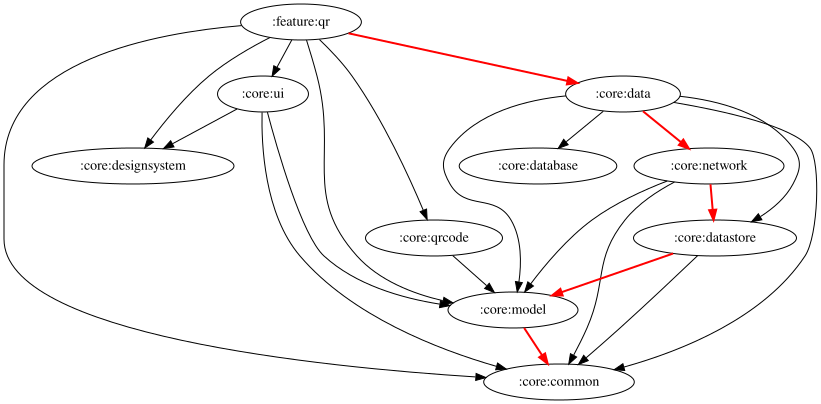
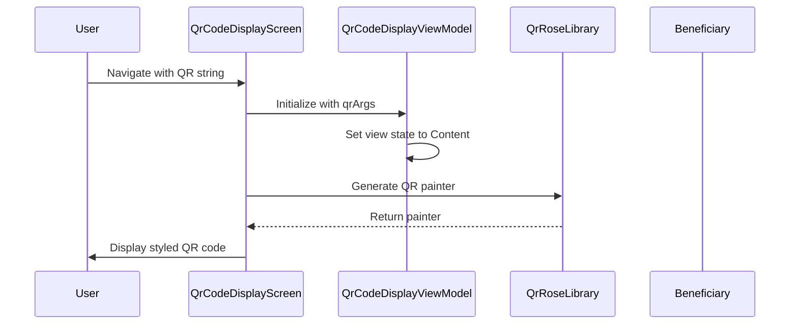
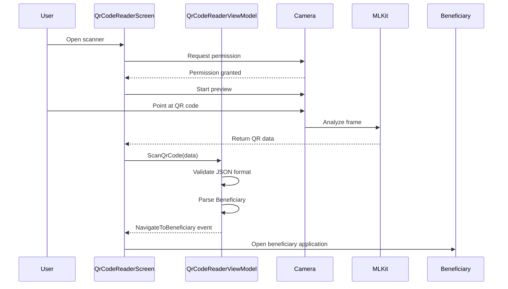
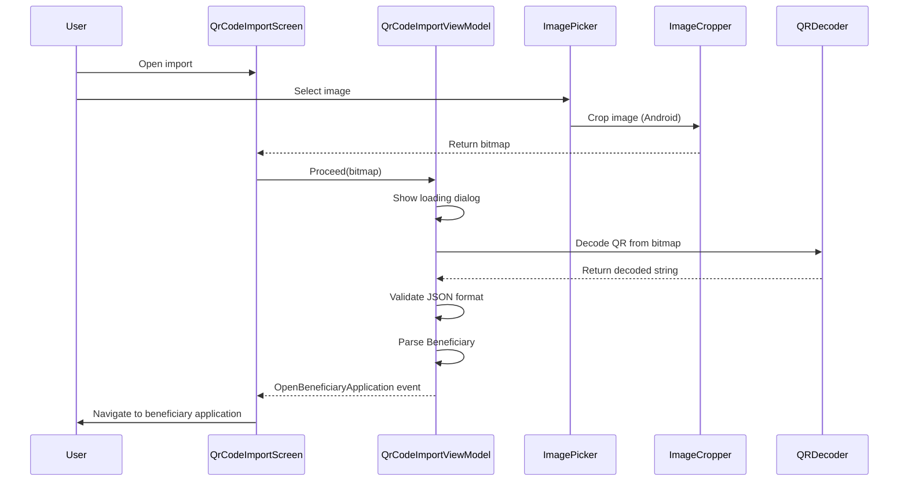

# :feature:qr Module

## Overview

The `:feature:qr` module provides QR code generation, scanning, and import functionality for the Mifos Mobile application. This module enables users to:
- Generate QR codes containing beneficiary account information
- Scan QR codes using device camera
- Import QR codes from image files
- Validate and parse QR code data to create beneficiary applications

## Dependency Graph



## Architecture

### High-Level Architecture

The `:feature:qr` module follows a clean architecture pattern with MVVM (Model-View-ViewModel) design, leveraging Kotlin Multiplatform for cross-platform support. The module is organized into three main feature screens:

```
feature/qr
├── qr/                    # QR Code Scanner Screen
│   ├── QrCodeReaderScreen.kt
│   ├── QrCodeReaderViewModel.kt
│   └── QrCodeReaderRoute.kt
├── qrCodeDisplay/         # QR Code Display Screen
│   ├── QrCodeDisplayScreen.kt
│   ├── QrCodeDisplayViewModel.kt
│   └── QrCodeDisplayRoute.kt
├── qrCodeImport/          # QR Code Import Screen
│   ├── QrCodeImportScreen.kt
│   ├── QrCodeImportViewModel.kt
│   └── QrCodeImportRoute.kt
├── navigation/            # Navigation Graph
│   └── QrNavGraph.kt
├── di/                    # Dependency Injection
│   └── QrModule.kt
└── platform/              # Platform-specific implementations
    ├── androidMain/       # Android-specific code
    ├── desktopMain/       # Desktop-specific code
    ├── nativeMain/        # iOS/Native-specific code
    └── jsMain/            # Web-specific code
```

### Module Dependencies

The `:feature:qr` module depends on:
- `:core:qrcode` - Core QR code generation and scanning utilities
- `:core:model` - Data models (Beneficiary, AccountType, etc.)
- `:core:designsystem` - UI components and design tokens
- `:core:ui` - Common UI utilities
- `:core:common` - Common utilities and helpers

### Key Libraries

- **qrose** - QR code generation and rendering
- **mlkit-barcode-scanning** (Android) - ML Kit for barcode scanning
- **filekit** - File picking and handling
- **krop** - Image cropping functionality
- **koin** - Dependency injection
- **kotlinx.serialization** - JSON serialization/deserialization

## Components

### 1. QR Code Reader (Scanner)

The QR Code Reader screen enables users to scan QR codes using the device camera.

#### QrCodeReaderViewModel

**Purpose**: Manages the state and business logic for QR code scanning.

**Key Responsibilities**:
- Handles camera permissions
- Processes scanned QR code data
- Validates QR code format (JSON)
- Parses beneficiary data from QR code
- Manages error dialogs

**State**: `QrCodeReaderState`
- `dialogState`: Current dialog state (Error or null)

**Actions**: `QrCodeReaderAction`
- `ScanQrCode(data: String)`: Triggered when a QR code is scanned
- `OnNavigate`: Navigate back
- `OnNavigateToUpload`: Navigate to QR import screen
- `OnDismiss`: Dismiss dialog

**Events**: `QrCodeReaderEvent`
- `Navigate`: Generic navigation event
- `NavigateToUploadQr`: Navigate to upload screen
- `NavigateToBeneficiary(beneficiary, state)`: Navigate to beneficiary application

**Workflow**:
1. User opens QR scanner screen
2. Camera permission is requested
3. User scans a QR code
4. Data is validated (must be JSON format)
5. JSON is parsed into Beneficiary object
6. Navigation event is emitted to open beneficiary application

#### QrCodeReaderScreen

**Purpose**: UI implementation for QR code scanning.

**Key Features**:
- Camera preview with QR code detection
- Visual corner markers for QR scanning area
- Warning message about QR code security
- Button to upload QR code from image instead of scanning
- Error dialog display

### 2. QR Code Display

The QR Code Display screen shows a generated QR code containing user's account information.

#### QrCodeDisplayViewModel

**Purpose**: Manages the state and styling for displaying QR codes.

**Key Responsibilities**:
- Receives QR string from navigation arguments
- Configures QR code styling (shapes, colors, error correction)
- Manages view state (Loading/Content)

**State**: `QrCodeDisplayState`
- `option`: Descriptive text to display
- `qrArgs`: String content to encode in QR code
- `viewState`: Current view state (Loading or Content)

**QR Code Styling**:
- **Shapes**: Circular pixels, rounded corners for ball and frame
- **Colors**: Blue (0xFF0673BA) for dark pixels, white for light
- **Error Correction**: Medium level for better readability

#### QrCodeDisplayScreen

**Purpose**: UI implementation for displaying QR codes.

**Key Features**:
- Displays generated QR code with custom styling
- Shows scan instructions
- Displays generation date
- Powered by Mifos branding footer

### 3. QR Code Import

The QR Code Import screen allows users to import QR codes from image files.

#### QrCodeImportViewModel

**Purpose**: Manages the logic for importing and decoding QR codes from images.

**Key Responsibilities**:
- Handles image selection
- Decodes QR code from image bitmap
- Validates decoded data
- Parses beneficiary data
- Manages loading and error states

**State**: `QrCodeImportState`
- `qrCodeResult`: Decoded QR code string
- `dialogState`: Current dialog state (Loading, Error, or null)

**Actions**: `QrCodeImportAction`
- `Proceed(bitmap: ImageBitmap)`: Process selected image
- `OnNavigate`: Navigate back
- `DismissDialog`: Dismiss dialog

**Events**: `QrCodeImportEvent`
- `Navigate`: Generic navigation event
- `OpenBeneficiaryApplication(beneficiary, state)`: Navigate to beneficiary application

**Workflow**:
1. User selects image from gallery
2. Image is cropped (Android) or selected directly
3. QR code is decoded from image
4. Data is validated (must be JSON format)
5. JSON is parsed into Beneficiary object
6. Navigation event is emitted to open beneficiary application

#### QrCodeImportScreen

**Purpose**: UI implementation for QR code import.

**Key Features**:
- Platform-specific image picker (expect/actual pattern)
- Image cropping on Android
- Loading indicator during processing
- Error dialog for invalid QR codes

### 4. Navigation

#### QrNavGraph

**Purpose**: Defines the navigation graph for the QR feature.

**Routes**:
- `QrGraphRoute`: Root navigation graph
- `QrCodeReaderRoute`: QR scanner screen
- `QrCodeDisplayRoute(qrString: String)`: QR display screen with data
- `QrCodeImportRoute`: QR import screen

**Navigation Functions**:
- `navigateToQrGraph()`: Navigate to QR feature
- `navigateToQrReaderScreen()`: Navigate to scanner
- `navigateToQrDisplayScreen(qrString)`: Navigate to display with data
- `navigateToQrImportScreen()`: Navigate to import

### 5. Dependency Injection

#### QrModule

**Purpose**: Provides ViewModels via Koin DI.

**Provided ViewModels**:
- `QrCodeImportViewModel`
- `QrCodeReaderViewModel`
- `QrCodeDisplayViewModel`

## Workflows

### QR Code Generation Workflow



### QR Code Scanning Workflow



### QR Code Import Workflow



## Data Models

### Beneficiary

The QR code contains beneficiary information in JSON format:

```json
{
  "clientName": "John Doe",
  "accountNumber": "123456789",
  "accountType": {
    "id": 1,
    "name": "Savings",
    "code": "savings"
  },
  "officeName": "Main Branch"
}
```

**Fields**:
- `clientName`: Name of the beneficiary client
- `accountNumber`: Account number
- `accountType`: Account type (Savings, Loan, etc.)
- `officeName`: Office/branch name

## Platform-Specific Implementations

### Android

**QR Code Import**:
- Uses `ActivityResultContracts.GetContent()` for image picking
- Uses `krop` library for image cropping
- Uses ML Kit for QR code decoding

**QR Code Scanning**:
- Uses CameraX for camera preview
- Uses ML Kit Barcode Scanning for QR detection
- Uses Accompanist Permissions for camera permissions

### Desktop

- Basic image picker implementation
- Simplified QR code scanning

### iOS/Native

- Uses Moko Permissions for camera permissions
- Native camera implementation
- Platform-specific image picker

### Web

- Web-based image picker
- Browser-based QR scanning (if supported)

## Usage Examples

### Generating a QR Code

```kotlin
// In the calling module
val qrString = getAccountDetailsInString(
    clientName = "John Doe",
    accountNumber = "123456789",
    accountType = AccountType(id = 1, name = "Savings", code = "savings"),
    officeName = "Main Branch"
)

navController.navigateToQrDisplayScreen(qrString)
```

### Navigating to QR Scanner

```kotlin
// Navigate to QR scanner screen
navController.navigateToQrReaderScreen()

// The scanner will handle:
// - Camera permissions
// - QR code detection
// - Data validation
// - Navigation to beneficiary application
```

### Navigating to QR Import

```kotlin
// Navigate to QR import screen
navController.navigateToQrImportScreen()

// The import screen will handle:
// - Image selection
// - Image cropping (Android)
// - QR code decoding
// - Data validation
// - Navigation to beneficiary application
```

### Integrating QR Feature

```kotlin
// In your navigation graph
qrNavGraph(
    navController = navController,
    openBeneficiaryApplication = { beneficiary, state ->
        // Handle beneficiary application opening
        navController.navigateToBeneficiaryApplication(beneficiary, state)
    }
)

// Navigate to QR feature
navController.navigateToQrGraph()
```

## Testing Scenarios

### Unit Testing ViewModels

```kotlin
class QrCodeReaderViewModelTest {
    @Test
    fun `when valid QR code is scanned, should emit NavigateToBeneficiary event`() {
        // Given
        val viewModel = QrCodeReaderViewModel()
        val validJson = """{"clientName":"John","accountNumber":"123"}"""
        
        // When
        viewModel.trySendAction(QrCodeReaderAction.ScanQrCode(validJson))
        
        // Then
        val event = viewModel.eventFlow.first()
        assertTrue(event is QrCodeReaderEvent.NavigateToBeneficiary)
    }
    
    @Test
    fun `when invalid QR code is scanned, should show error dialog`() {
        // Given
        val viewModel = QrCodeReaderViewModel()
        val invalidData = "not a json"
        
        // When
        viewModel.trySendAction(QrCodeReaderAction.ScanQrCode(invalidData))
        
        // Then
        val state = viewModel.stateFlow.value
        assertTrue(state.dialogState is QrCodeReaderState.DialogState.Error)
    }
}
```

### UI Testing

```kotlin
class QrCodeReaderScreenTest {
    @Test
    fun `when screen loads, should show camera preview`() {
        composeTestRule {
            QrCodeReaderScreen(
                navigateBack = {},
                openBeneficiaryApplication = { _, _ -> },
                navigateToQrImportScreen = {}
            )
        }
        
        // Verify camera preview is displayed
        // Verify instruction text is shown
        // Verify upload button is displayed
    }
}
```

## Error Handling

### Common Error Scenarios

1. **Camera Permission Denied**
   - Shows permission denied UI
   - Provides button to open settings
   - Uses `CameraPermissionState` to manage permissions

2. **Invalid QR Code Format**
   - Validates JSON format (must start with `{` and end with `}`)
   - Shows error dialog with message
   - Allows user to retry

3. **QR Code Parsing Error**
   - Catches JSON parsing exceptions
   - Shows error dialog
   - Logs error for debugging

4. **Image Import Error**
   - Handles crop errors
   - Shows error dialog
   - Allows user to select different image

## Security Considerations

- QR codes contain sensitive beneficiary information
- Users are warned about scanning untrusted QR codes
- Data is validated before processing
- Only JSON-formatted QR codes are accepted
- Beneficiary data is not stored locally after scanning

## Future Enhancements

Potential improvements for the module:
- Support for additional barcode types beyond QR
- QR code history/log
- Batch QR code scanning
- Custom QR code styling options
- Enhanced error messages and user guidance
- Offline QR code generation
- QR code sharing functionality

## Contributing

When contributing to the `:feature:qr` module:
1. Follow the existing MVVM architecture
2. Use the BaseViewModel pattern for new ViewModels
3. Add KDoc comments for public APIs
4. Implement platform-specific code using expect/actual
5. Test on multiple platforms (Android, iOS, Desktop, Web)
6. Update this README for new features or changes
